# Swift Spinner Collection

28 handcrafted SwiftUI loading spinners, from classic arcs, pulses and bouncing dots to illustrated ones like a frying egg, melting ice cream and a tumbleweed. Each is drawn with `Canvas` and `TimelineView`, scales to any size, and supports live color, gradients, hue cycling and speed control.

This repository is both a **Swift package** you can add to your own app and a **demo app** that shows every spinner and lets you play with it.

<p align="center">
  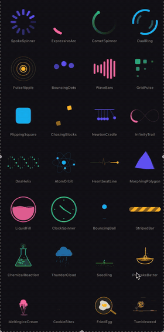
</p>

## Highlights

- **28 spinners**: 20 classic loading indicators and 8 illustrated, story-telling ones
- **Swift package**: add it with Swift Package Manager and `import Spinners`
- **Pure SwiftUI**: every spinner is a single `Canvas` driven by `TimelineView`, with no images, Lottie files or third-party code
- **Any size**: everything is drawn relative to the view's size, from a 20 pt inline indicator to full screen
- **Live customization** on every detail screen of the demo app:
  - a hue slider to recolor the spinner
  - a gradient switch with a second hue slider
  - color cycling that glides round the full color wheel in time with the animation
  - an animation speed slider from 0.25× to 4×
- **Accessible**: animations pause when Reduce Motion is on, and VoiceOver reads each spinner as "Loading"
- **Multiplatform**: iOS, iPadOS, macOS and visionOS

## Screenshots

<p align="center">
  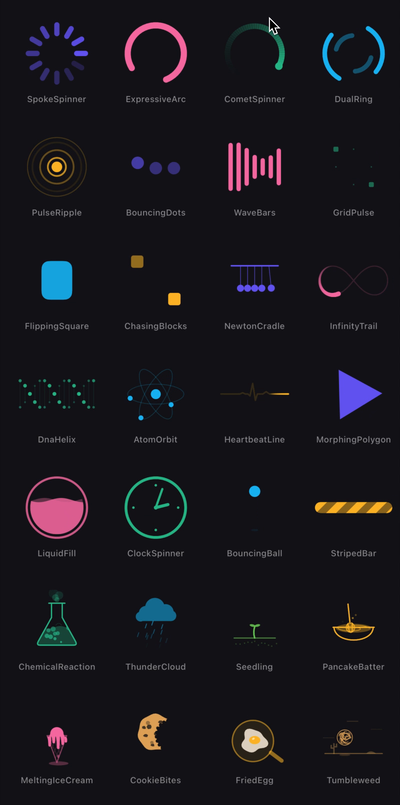
  &nbsp;
  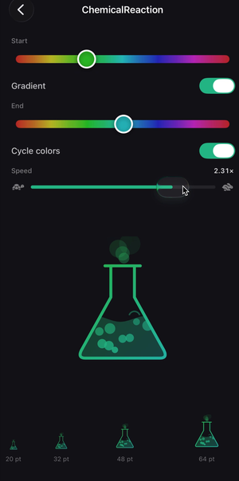
  &nbsp;
  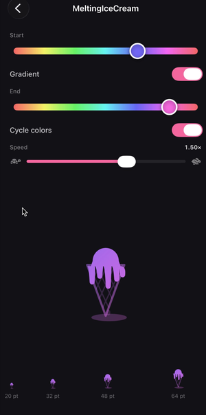
  &nbsp;
  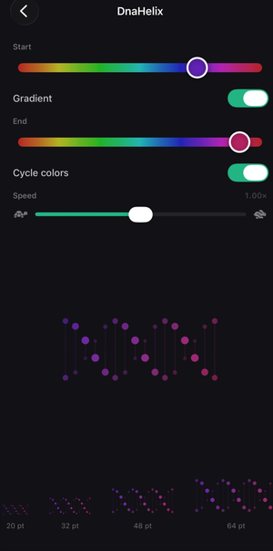
</p>

## In motion

| | | |
|:---:|:---:|:---:|
| 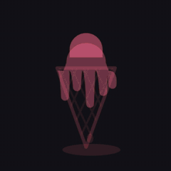<br>`MeltingIceCream` | 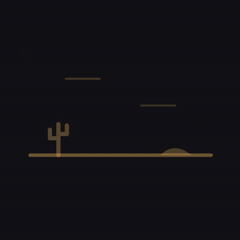<br>`Tumbleweed` | 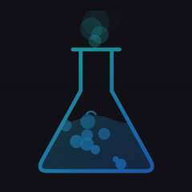<br>`ChemicalReaction` |
| 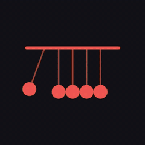<br>`NewtonCradle` | <br>`PancakeBatter` | 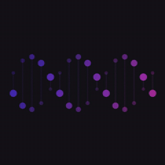<br>`DnaHelix` |

### Color, gradient, cycling and speed

<p align="center">
  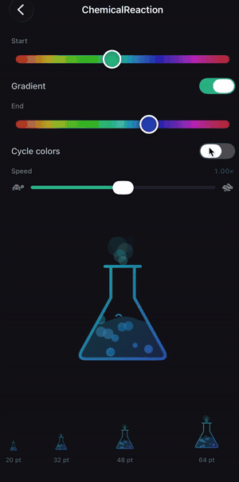
</p>

## All spinners

**Classic**

| Spinner | What it does |
|---|---|
| `SpokeSpinner` | Ring of spokes with a bright head stepping clockwise |
| `ExpressiveArc` | Material-style arc that grows and shrinks while it spins |
| `CometSpinner` | Bright head with a long fading tail |
| `DualRing` | Two pairs of arcs spinning in opposite directions |
| `PulseRipple` | Pulsing core sending out fading rings |
| `BouncingDots` | Three dots hopping one after another |
| `WaveBars` | Equalizer bars rippling in a wave |
| `GridPulse` | 3×3 tiles shrinking and growing in a diagonal wave |
| `FlippingSquare` | Square flipping over one axis, then the other |
| `ChasingBlocks` | Two blocks tumbling round the corners of a square |
| `NewtonCradle` | Newton's cradle with swinging end balls |
| `InfinityTrail` | Tapered comet racing round a figure-eight |
| `DnaHelix` | Two dotted strands twisting with depth |
| `AtomOrbit` | Electrons circling a nucleus on tilted orbits |
| `HeartbeatLine` | Glowing pulse drawing an ECG trace |
| `MorphingPolygon` | Shape morphing from circle to triangle to hexagon |
| `LiquidFill` | Round flask filling and draining with rolling waves |
| `ClockSpinner` | Clock face with spinning hands |
| `BouncingBall` | Ball bouncing under gravity, squashing on impact |
| `StripedBar` | Indeterminate barber-pole progress bar |

**Illustrated**

| Spinner | What it does |
|---|---|
| `ChemicalReaction` | Bubbling flask with popping bubbles and smoke |
| `ThunderCloud` | Rain cloud with slanted rain and lightning |
| `Seedling` | Seed sprouting, unfolding its leaves and swaying |
| `PancakeBatter` | Whisk circling through a bowl of swirling batter |
| `MeltingIceCream` | Scoop sagging and dripping down a waffle cone |
| `CookieBites` | Chocolate chip cookie eaten bite by bite |
| `FriedEgg` | Egg cracking into a pan and sizzling |
| `Tumbleweed` | Tumbleweed bouncing across the desert |

## Installation

The spinners ship as a Swift package with one library, `Spinners`.

**Xcode:** File → Add Package Dependencies…, paste

```
https://github.com/karmicDev/Swift-Spinner-Collection.git
```

choose **Up to Next Major Version** from `1.0.0`, and add the `Spinners` library to your app target.

**Package.swift:**

```swift
dependencies: [
    .package(url: "https://github.com/karmicDev/Swift-Spinner-Collection.git", from: "1.0.0"),
],
targets: [
    .target(name: "MyApp", dependencies: [
        .product(name: "Spinners", package: "Swift-Spinner-Collection"),
    ]),
]
```

Only the package in `Sources/Spinners` is built into your app; the demo app and the images in this repository are never part of it. You get all 28 spinners and use whichever you like. They're small, code-only views with no images or other resources, so the whole set adds very little to your app. If you'd rather not add a dependency, each spinner is a single file: copy it into your project along with `SpinnerSupport.swift`.

## Usage

Every spinner is a plain SwiftUI view. Import the package and give it a size:

```swift
import Spinners

SpokeSpinner()
    .frame(width: 40, height: 40)

// Any color
CometSpinner(color: .mint)
    .frame(width: 32, height: 32)

// Most spinners expose their timing too
MeltingIceCream(color: .pink, period: 4)
    .frame(width: 64, height: 64)

// Any spinner with a gradient
GradientSpinner(colors: [.pink, .orange]) { CometSpinner(color: $0) }
    .frame(width: 48, height: 48)
```

To run every spinner faster or slower, set the shared time scale in the environment:

```swift
VStack {
    SpokeSpinner()
    WaveBars()
}
.environment(\.spinnerTimeScale, SpinnerTimeScale(speed: 2))   // 2× speed
```

## How it works

- **Time-driven, not state-driven.** `SpinnerClock` wraps `TimelineView(.animation)` and hands each spinner the current time. Every frame is computed from that time alone, with no `@State` and no `withAnimation`, so animations never drift. The same time is also used to step the colors in sync with the motion.
- **Drawn with `Canvas`.** Each spinner draws its frame in one `Canvas`. The illustrated ones are drawn in fixed design coordinates and scaled to fit the view.
- **One color, many shades.** Every spinner is drawn in a single color with varying opacity. That's what lets the color slider, color cycling and gradients work for all of them: a gradient is the spinner drawn in white and used as a mask (`GradientSpinner`).
- **Smooth speed changes.** `SpinnerTimeScale` maps real time to animation time and re-anchors whenever the speed changes, so the animation continues from where it is instead of jumping.

## Demo app

The demo app in `Example/` shows all 28 spinners in a full-screen grid. Tap one to open its detail screen, where you can:

- recolor it with a hue slider
- switch on a gradient and pick its second color
- let the color cycle round the color wheel in time with the animation
- slow it down to 0.25× or speed it up to 4×
- see it at real UI sizes from 20 to 64 pt

To run it, open `Example/SpinnerCollection.xcodeproj` in Xcode and press Run. The demo uses the package straight from this repository, so any change to a spinner in `Sources/Spinners` shows up in the demo on the next build.

## Repository layout

```
Package.swift                     # The Swift package: one library, "Spinners"
Sources/Spinners/
├── SpinnerSupport.swift          # Palette, SpinnerClock, time scale and math helpers
├── GradientSpinner.swift         # Fills any spinner with a gradient
└── CometSpinner.swift …          # One file per spinner, each with its own #Preview
Example/                          # The demo app (not part of the package)
├── SpinnerCollection.xcodeproj
└── SpinnerCollection/
    ├── ContentView.swift         # Gallery grid, detail screen and controls
    └── SpinnerCollectionApp.swift
docs/                             # Screenshots and GIFs for this README
```

## Requirements

- **Package:** iOS / iPadOS 18, macOS 15 or visionOS 2, Swift 6.2 (Xcode 26)
- **Demo app:** Xcode 26, iOS / iPadOS 26.2, macOS 15.7 or visionOS 26.2

Every spinner file also has an Xcode preview, so you can try a spinner without running the app.

## Author

Michael Karbe ([@karmicDev](https://github.com/karmicDev))
